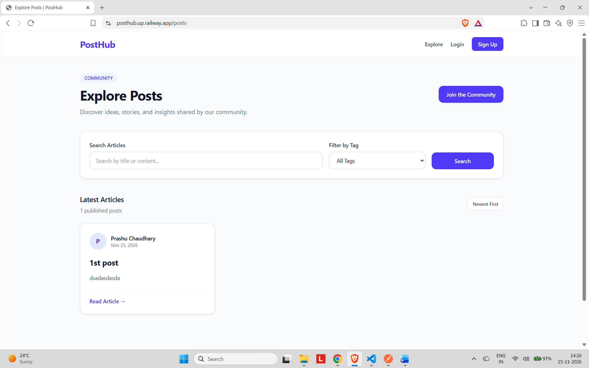
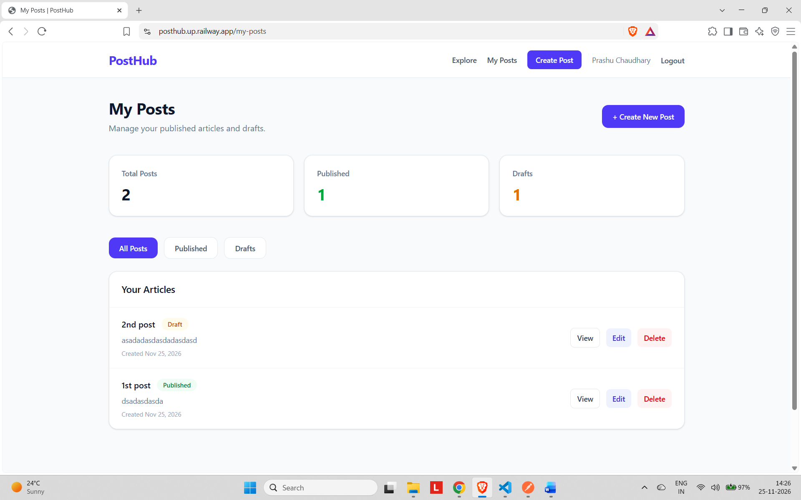
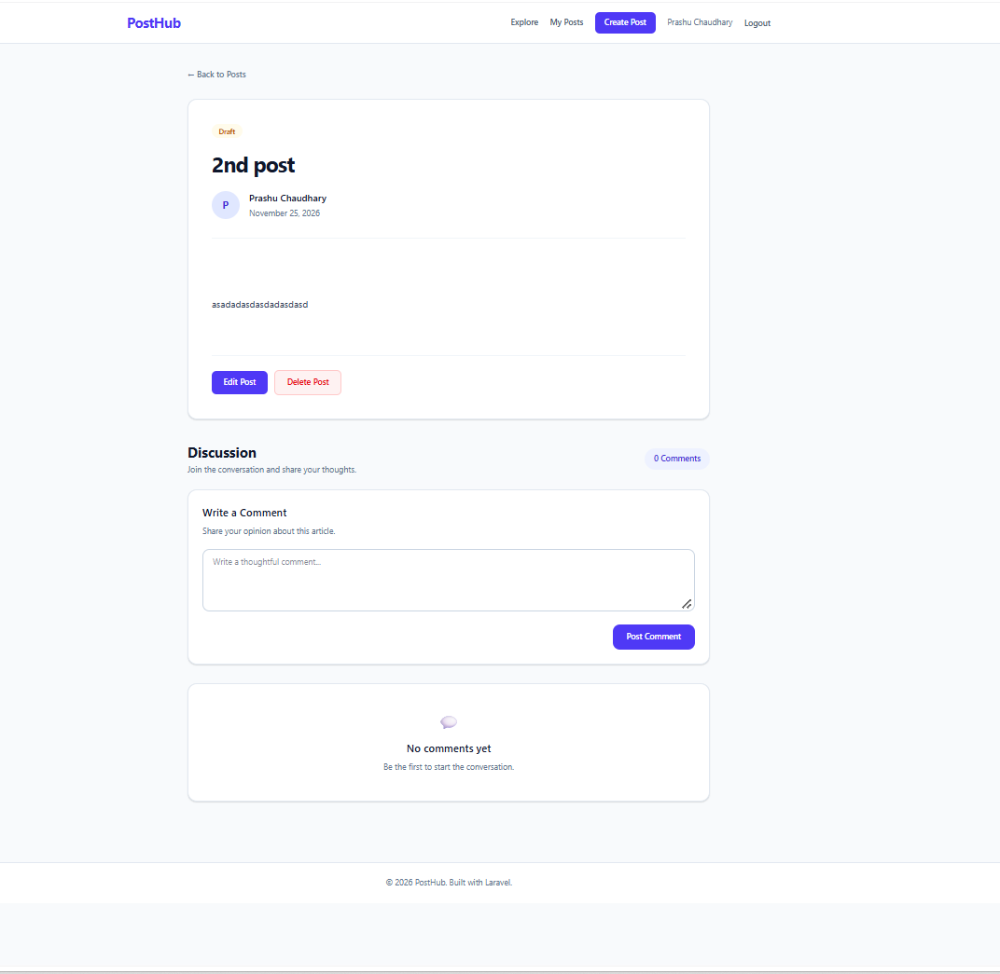

# PostHub — Full-Stack Laravel Blogging Platform

PostHub is a full-stack blogging and community platform built using Laravel 13, PHP 8.4, Blade, Tailwind CSS, and MySQL.

The application enables users to publish articles, manage drafts, explore community content, and participate in discussions.

It also provides a REST API secured with Laravel Sanctum and uses Laravel Policies for authorization.

## Live Demo

**Website:** https://posthub.up.railway.app/

**Source Code:** https://github.com/PrashuChoudhary000/PostHub

## Application Screenshots

### Homepage

### Explore Posts

### My Posts Dashboard

### Article Details and Comments

## Technology Stack

### Backend
- PHP 8.4
- Laravel 13
- Laravel Fortify
- Laravel Sanctum
- Eloquent ORM
- MySQL

### Frontend
- Laravel Blade
- Tailwind CSS 4
- Vite
- Responsive layouts

### Testing
- Pest / PHPUnit
- SQLite in-memory testing database
- Laravel Feature Tests

### Deployment
- Railway
- GitHub
- Railway MySQL
- HTTPS

## Features

### Authentication
- User registration
- Login and logout
- Session-based web authentication using Fortify
- Token-based API authentication using Sanctum
- Password validation and hashing

### Post Management
- Create, read, update and delete posts
- Publish articles or save them as drafts
- Manage articles through My Posts
- Published and Draft filters
- Post ownership authorization

### Community
- Explore published articles
- Search articles by title and content
- Filter articles by tags
- Comment on published articles
- View comment authors
- Pagination

### Security
- Laravel Policy authorization
- CSRF protection for web forms
- Server-side validation
- Draft visibility restrictions
- Authenticated user ownership
- Database transactions
- Protection against unauthorized updates and deletion

## Application Pages

| Page | Description |
|---|---|
| Home | Landing page and community statistics |
| Explore Posts | Browse and search published articles |
| Register | Create an account |
| Login | Authenticate an existing user |
| My Posts | Manage published articles and drafts |
| Create Post | Write a new article |
| Edit Post | Update an existing article |
| Post Details | Read an article and participate in discussions |

## REST API Endpoints

| Method | Endpoint | Description |
|---|---|---|
| POST | /api/register | Register user |
| POST | /api/login | Authenticate user |
| POST | /api/logout | Logout |
| GET | /api/me | Authenticated user |
| GET | /api/posts | List posts |
| POST | /api/posts | Create post |
| GET | /api/posts/{post} | View post |
| PUT/PATCH | /api/posts/{post} | Update post |
| DELETE | /api/posts/{post} | Delete post |
| POST | /api/posts/{post}/comments | Add comment |
| GET | /api/posts/{post}/comments | List comments |

API endpoints for managing posts and comments use Sanctum authentication and Laravel Policies.

## API Authentication

After obtaining a token through the login endpoint, send authenticated API requests using:

    Authorization: Bearer YOUR_TOKEN
    Accept: application/json

Browser authentication uses Fortify and session cookies.

## Eloquent Relationships

The application demonstrates:

- User has many Posts
- Post belongs to User
- Post belongs to many Tags
- Post has many Comments
- Comment belongs to User

Eager loading is used to reduce unnecessary database queries.

## Search and Filtering

The Explore Posts page supports:

- Keyword search
- Tag filtering
- Combined filters
- Pagination with retained query parameters

Example:

    GET /posts?search=Laravel&tag_id=1

Only published posts appear in public search results.

## Automated Testing

The application includes automated tests covering:

- API authentication and authorization
- Post creation and updates
- Post ownership protection
- Comment validation and ownership
- Draft privacy
- Search and tag filtering
- Pagination and relationships
- Homepage rendering

Latest verified local results:

**40 tests passed — 113 assertions**

Run the test suite:

    php artisan test

Tests use SQLite, while local development and production use MySQL.

## Local Installation

### Requirements

- PHP 8.4+
- Composer
- Node.js and npm
- MySQL

### Setup

Clone the repository:

    git clone https://github.com/PrashuChoudhary000/PostHub.git

Enter the project directory:

    cd PostHub

Install PHP dependencies:

    composer install

Install frontend dependencies:

    npm install

Copy environment configuration:

    cp .env.example .env

Generate the application key:

    php artisan key:generate

Configure your local MySQL connection in `.env`.

Run migrations:

    php artisan migrate

Build frontend assets:

    npm run build

Run the application:

    php artisan serve

## Production Deployment

PostHub is deployed using Railway.

The application uses:

- PHP 8.4
- MySQL database service
- Production Vite assets
- Railway environment variables
- Laravel migrations
- HTTPS

Production environment variables are configured through Railway rather than committed to GitHub.

## Project Purpose

PostHub was developed to demonstrate practical experience in:

- Full-stack Laravel development
- REST API design
- Authentication and authorization
- Relational database design
- Secure data handling
- Automated testing
- Cloud deployment

The project combines a working web application with a separate REST API.

## Future Improvements

- User profile pages
- Rich-text article editor
- Article cover images
- Email verification flow
- Improved content moderation
- Expanded automated test coverage

## License

MIT
